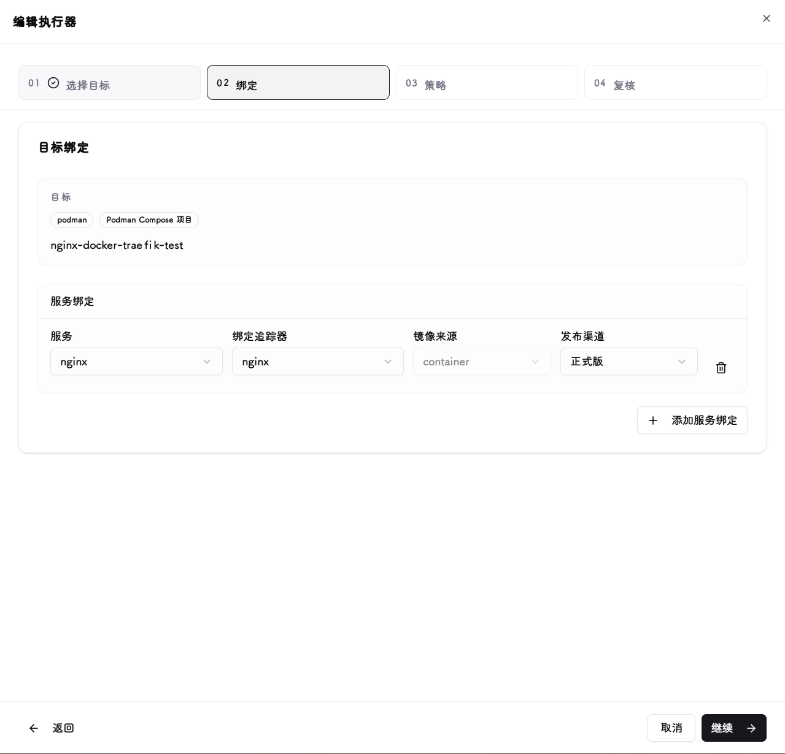

# Executors and update policies

Executors bind a source's release channel to a running service. First verify [version filtering](trackers.md#verify), [runtime connectivity](runtime-connections.md#verify), and the target's [support status](../reference/support.md#runtimes).

## Create and bind {#bindings}

1. Create an executor, select a runtime connection, and discover targets.
2. Bind the target to a specific tracker source and release channel; for multi-service targets review each binding and do not point different services at the same image source.
3. Start in manual mode and review the target image or chart version before saving.

## SSH Compose targets {#ssh-compose}

After selecting an [SSH host connection](runtime-connections.md#ssh), Compose projects on the remote host can be discovered automatically. If discovery is unreliable, enter the working directory, Compose files (in load order), environment files and profiles manually. **Analyze** parses the project read-only so you can confirm the Compose tool, services and where each version comes from.

| Write strategy | Behavior |
| --- | --- |
| Edit original files / environment | Update the image reference in place in the Compose or environment file |
| Separate image override file | Create and maintain a ReleaseTracker-owned override file without touching the originals; use it when variables come from the process environment |

Only the images of selected services change; complex image expressions, shared variables or build-only services are refused. A project can be owned by one executor only. Project files are snapshotted before updating. If a disconnect leaves the result uncertain, the project stays locked: confirm the remote command has stopped, then choose **Restore configuration files** or **Verify and unlock** in the executor. Restoring files does not roll back running containers.

## Triggers {#policies}

| Mode | Execution behavior |
| --- | --- |
| Manual | Triggered explicitly in the UI |
| Immediate | Runs automatically when a new target version is detected |
| Maintenance window | Runs automatically only on allowed days and times, interpreted in the system time zone |

The window constrains only the first remote write of an automatic deployment; multi-step updates and readiness observation already in progress may finish after it closes. Runs are skipped when no matching target version exists, the configuration is disabled, or the target is already current.

## Image selection {#images}

| Policy | Use when |
| --- | --- |
| Replace current image tag | Keep the current registry/repository and use the source's version tag |
| Use tracker image and tag | Use the image repository configured in the OCI source |
| Digest reference | Pin a specific build when the source supplies a usable digest |
| Tag reference | Reference a version label; upstream can republish the same tag |

Tag mode always uses `image:tag`; neither queueing nor an unchanged tag adds a digest. An unchanged image reference is skipped. Choose Digest mode to pin and apply a specific artifact when the same tag is republished. Switching between Tag and Digest applies the new reference form even when the artifact digest matches.

Helm releases do not use these fields; they select chart versions. A matching Git tag does not guarantee an image tag exists; check the repository and build publication rules.

## Automatic version limits {#version-policy}

Choose no limit (default), minor-and-patch only, or patch only. Range checks share target-selection parsing and retain comparable legacy formats; prereleases still need review. Out-of-range changes go to [deployment plan approval](#approval) without spending retries. **Every policy and manual trigger requires explicit approval for downgrades or unknown direction.** No limit allows major upgrades, not unattended downgrades. Containers use running image tags; Helm uses chart versions, not appVersion; groups compare bound services only. Missing reliable running versions always require approval. Manual initiation bypasses upgrade-range limits, not direction checks. A changed digest under one tag is an artifact change, not necessarily an upgrade.

After selection rules change, old tasks retain their original targets but cannot reuse old approval to execute. Review the new target and create a new task; an approved target is never silently replaced.

## Deployment plan approval {#approval}

Before deploying, ReleaseTracker reads the target state and builds a deployment plan. The task stops at **Deployment plan approval required** and sends a "Deployment approval required" notification when:

- the target is onboarded for the first time, or lacks ReleaseTracker ownership markers;
- the running configuration differs from the last managed baseline (configuration drift);
- the target version is outside the [version limit](#version-policy);
- the update is manual and its configuration diff needs review.

Deployment results, readiness and managed baselines are recorded separately. Missing runtime evidence is retried with backoff by an independent worker. Missing historical approval proof or conflicting configuration/ownership produces **Baseline needs review**, without changing deployment success to failure or blocking unrelated instances solely for baseline review. The next actual update still requires configuration review. Automatic reconciliation accepts only evidence proven to match the original target and approved configuration.

Task details identify blocking tasks and provide **Recheck baseline**. This is a read-only operation: it neither redeploys nor approves configuration, and cannot reconstruct missing historical approval. Baseline checks stop when a newer deployment supersedes them. Interrupted writes and unknown runtime outcomes retain their safety gates until reconciled.

Helm downloads the Chart archive first and, when the target includes a SHA256 digest, verifies it before upgrading from that exact file. The same version with a different digest is not skipped. The receipt is bound to the Helm release revision, so external upgrades invalidate the old artifact proof. Repositories without digests retain version-based selection without an approval-time content guarantee. OCI manifest digests cannot verify Chart archive bytes.

In the task details, review the target, runtime identity, configuration fingerprint, recovery scope and configuration diff (sensitive values hidden), then click **Approve and continue**. Approvals expire and are bound to the current evidence; if the configuration changes before execution, **Refresh plan** and approve again. A plan whose diff is not fully displayed cannot be approved.

If the target is owned by another instance or executor, its markers conflict, or the marker version is unsupported, the deployment is **blocked**; approval cannot override it and ownership must be resolved first.

If the previous executor was deleted and local history proves an approved write matching the runtime, target and stale markers, the target can be reviewed again as a first onboarding. Markers are replaced only after approval and execution, never automatically. Without verifiable history the target stays blocked.

## Verify one update {#verify}

Before running, check the target version, image policy and service bindings. Afterwards inspect status, target versions and per-service diagnostics in execution history and the **Task queue**, then check application availability.

- Enable Immediate or Maintenance Window only after a successful manual run.
- If a task shows that its execution state needs confirmation, verify the actual runtime state before unblocking it.
- A write timeout does not mean nothing changed; see [Update timeout](../reference/troubleshooting.md#update-timeout). For validation and recovery see [Health checks and rollback](health-and-rollback.md).
