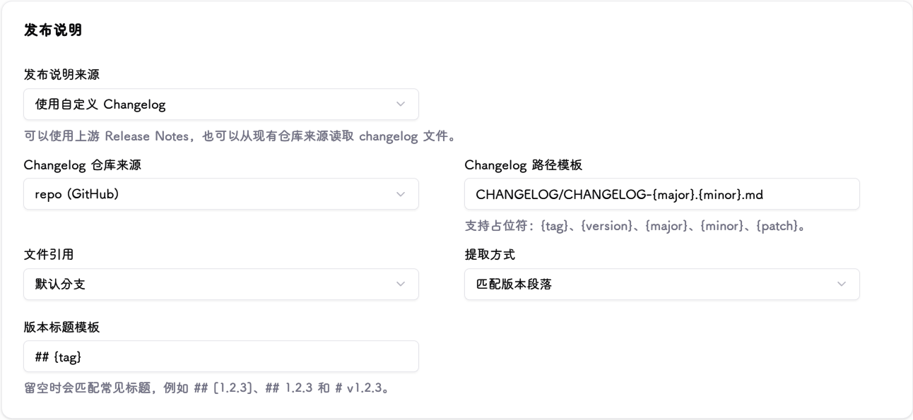

# Trackers and version rules

Trackers discover and filter versions; they do not modify services. Runtime updates require an [executor](executors.md).

## Add version sources {#sources}

Under **Trackers → Add**, choose an immutable tracker name and add one or more sources. The UI's “tracking channel” means a version source, not the release channel described below.

| Source | Required information | Notes |
| --- | --- | --- |
| GitHub | `owner/repo` | Start with REST-first without credentials; GraphQL-first requires a PAT |
| GitLab | Project ID or `group/project` | Set the instance URL for self-hosted GitLab |
| Gitea | `owner/repo`, instance URL | Private repositories require a token |
| Helm chart | Chart name, repository URL | Private repositories can use Basic Auth |
| OCI image | Image name, registry address | Private registries require matching credentials |

See [Credentials and runtimes](runtime-connections.md#credentials) for authentication and HTTPS requirements. A tracker can contain both GitHub releases and OCI images; an executor binds to a specific source, not just a project name.

## Filter release channels {#channels}

Each source can configure `stable`, `prerelease`, `beta`, and `canary` channels. A channel name is separate from the upstream Release / Pre-Release status; do not infer filtering behavior from its name alone.

| Setting | Rule |
| --- | --- |
| Release type | GitHub / GitLab / Gitea can filter Release or Pre-Release |
| Include pattern | Keep matching version tags; blank means unrestricted |
| Exclude pattern | Remove matches after inclusion; exclusion takes precedence |

For example, `^v?1\.2\.\d+$` selects three-part versions on the `1.2.x` line. Run a manual check and verify the tags before binding this channel to an executor.

## Fetching and latest detection {#fetching}

| Setting | Selection guidance |
| --- | --- |
| Check interval | Default 360 minutes; shorter intervals increase upstream requests |
| Fetch depth | Default 10 entries; increase for frequently updated projects |
| Request timeout | Default 15 seconds; applies to source fetching, not runtime updates |
| Version selection | Highest comparable version; Helm compares chart version, not appVersion |
| Release fallback | Can fetch raw Git tags when upstream returns no releases |

Time-based selection is no longer offered. Legacy `published_at` sorting settings remain readable but use version selection. Time never breaks ties between different artifacts of an equivalent version: a tag follows its current digest; conflicting equivalent-version aliases must be resolved first. Non-version tags such as `latest` and `nightly` require an explicit exact include rule, such as `^nightly$`, and do not compete for the highest version.


### General tag ordering

The channel rule determines membership; the retired `version_format` setting is ignored. Standard versions use version comparison, integer-only channels use numeric order, and integers never outrank dotted versions in a mixed repository. Matching numbered formats such as `build-99` / `build-100` or dates use natural ordering. Different text patterns cannot be ordered by their names.

For container tags, compact hexadecimal strings of 7–64 characters containing a letter (such as `361952a`) are ambiguous commit identifiers and do not enter default version ordering. This prevents PEP 440 from mistaking a hash for a very large version. They remain in inventory; explicit numeric fields or an exact pinned tag still work. GitHub and Helm version parsing is unchanged.

For complex tags, capture a numeric `version` and optional `revision` in the include pattern. Both `(?<version>...)` and Python `(?P<version>...)` work. For example:

```regex
^(?<version>\d+)\.v[\w_]+-(?<revision>\d+)$
```

This compares the build number, then the image revision, ignoring the hash. Equal version keys pointing to different digests still conflict. The form's ordering preview uses the same backend rules without saving or fetching. Actual targets also require digest confirmation.

Click “Show problem tags” to open the diagnostics dialog. Search and pagination stay visible while tags scroll independently; channel rules start collapsed. The ordering basis is determined automatically from channel rules and displayed read-only, including ordinary versions and explicit numeric fields. There is no reference selector. Include/exclude rules are applied before reporting tags that actually cause the failure; unrelated hashes, floating tags and ignored integer aliases are omitted. When no common basis exists, show family counts and at most three sample tags per family without guessing which family is wrong. Diagnostics never change rules, choose a target or bypass selection blocks.

Unorderable tags remain visible in channel history, but do not produce an automatic target. There is no time fallback. Custom numbers do not imply major/minor/patch policy semantics; uncertain deployment direction still requires review. Each channel keeps its own retention quota using its ordering fields; deterministic audit order for unknown formats is not an upgrade direction.
Container fetching never reads Config blobs, build times or OCI labels; legacy `published_at_mode` is ignored. Dates never rank versions. Compact dates prefer genuine push time, then registry registration, then explicitly labeled registry modification. Unknown dates never use discovery/build fallbacks. Hover/focus reveals full semantics; the column remains on mobile.

| Registry | Native date and semantics |
| --- | --- |
| Docker Hub | Public tag API `tag_last_pushed`, exact tag/top-level digest matching; no registry credentials sent |
| GHCR | Packages version `created_at`, exact digest/tag matching, labeled registration; never `updated_at` as push time |
| Quay / self-hosted Quay | Tag API `start_ts` / `last_modified`, exact tag/manifest matching, labeled tag registration / modification |
| Harbor | Artifact API `push_time`, digest/tag matching; detected via same-origin `/service/token` challenge |
| JFrog / other OCI registries | `Last-Modified` from the manifest HEAD/GET supplying the digest, explicitly modification not push, no additional requests |

Native metadata shares a 10-request / 5-second budget. Errors, permissions, throttling or timeouts never block tags/digests. Known dates persist for the same digest but never transfer to its replacement. Observation dates remain internal.

Registry date lookups reuse the container source's pull credential; there is no separate credential. GHCR sends it to `api.github.com` only when it is an identifiable GitHub token (with `read:packages`) for the fixed first-party pair, never an exchanged OCI bearer token. Quay/Harbor authentication stays same-origin; self-hosted Quay uses the `/v2/auth` challenge. If the credential lacks permission or the API is unavailable, a verified manifest modification date may still be shown; otherwise Unknown. Metadata refuses cross-origin redirects.

The upgrade preserves historical identities and queued task records but invalidates legacy approvals. Startup rebuilds current views from local history without fetching, notifying or deploying. Legacy automatic target snapshots are rejected rather than silently replaced; regenerate review under the new selection rules.
History retention is independent for each tracking channel. Two channels with a limit of 20 retain up to 20 records each. Shared records count against each channel independently; pruning keeps the union. Records required by current targets and unsettled deployment/recovery tasks are separately protected. Cleanup runs after fetches and at startup, with scheduled maintenance as a fallback.

Current tag pointers and channel decisions are independent of retained history. The version view includes the current snapshot even when history is paginated. Container channels automatically recognize comparable versions and can extract custom numeric ordering fields from their include pattern. Floating tags require an exact match. An unconfirmed highest manifest, equivalent-version artifact conflict, or a locally bootstrapped inventory prevents automatic deployment rather than falling back to a lower version. Non-container sources still depend on upstream fetch coverage.

## Custom changelog {#changelog}

Keep Release Notes when upstream already supplies them. Use a custom changelog only when notes live in a repository file; the tracker must include a GitHub, GitLab, or Gitea source.

| File layout | Path template | Extraction mode |
| --- | --- | --- |
| One file, multiple versions | `CHANGELOG.md` | Matched version section |
| One file per version | `docs/releases/{version}.md` | Entire file |
| Kubernetes-style | `CHANGELOG/CHANGELOG-{major}.{minor}.md` | From subheading in matched section |

Paths support `{tag}`, `{version}`, `{major}`, `{minor}`, and `{patch}`. Read from the default branch, release tag, or a specified branch / tag / commit. Leave the heading template blank for automatic matching; specify it if matching fails. Subheading extraction needs a prefix such as `Changelog since`.



## Repository webhooks {#repository-webhooks}

In addition to scheduled checks, a Git platform can ask ReleaseTracker to refresh immediately when a release is published or an Actions run succeeds. Webhooks only schedule a source refresh under the existing rules; payloads never create releases or trigger deployments.

1. Under **Webhooks → Repository Webhooks**, choose a Git source and platform protocol (GitHub, GitLab, Gitea, Forgejo).
2. Set a verification secret of at least 16 characters. GitHub / Gitea / Forgejo sign the body with HMAC-SHA256; for GitLab prefer the signing token (`whsec_`) and use the secret token only for legacy instances.
3. Choose events: release published, Actions run succeeded. Branch and workflow filters apply only to Actions events.
4. To refresh images or charts after a successful build, select OCI / Helm sources of the same tracker under **Linked artifact sources**.
5. Enter the generated endpoint (`{BASE URL}/api/webhooks/repository/{id}`) and secret in the Git platform, enable the webhook, and confirm receipt in its delivery log.

The endpoint must be reachable from the Git platform. Requests with a missing or wrong signature are rejected; duplicate deliveries are deduplicated and shown in the delivery log.

## Verify the result {#verify}

After a manual check, inspect the version tag, source, channel, and release notes. Disabling a tracker stops scheduled checks without deleting configuration. Use [missing or unexpected versions](../reference/troubleshooting.md#versions) to troubleshoot. Fix the rules before enabling automatic execution.
