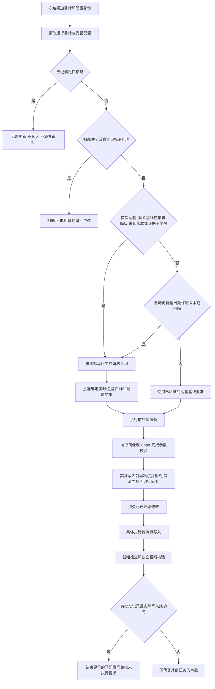

# 执行器更新流程优化实施记录

本文对应 [原始流程审查](executor-update-flow-2026-10-26.md) 的 P1–P6。原审查中的图表示修改前代码；本文描述修改后的判断。生产任务不会因本地修改自动改变。

## 公共准入与任务结束

- 删除无风险手动更新的统一 `manual_update_review`。手动仅沿用已有的版本范围及维护窗口例外，不绕过首次纳管、漂移、未知版本、降级和身份复核。
- 同目标结束必须核对 executor、完整配置身份、来源/渠道/别名、Tag/Digest、Chart 版本/摘要；源任务必须 `succeeded`、有 `mutation_started=true` 和 approved/applied 计划。后来的不确定写入会阻止旧成功记录继续结束请求。
- 只结束更早、没有 owner、尚未开始修改的 queued/retry_wait 请求。运行中、需人工处理、不同摘要或配置、已经取消的任务不受影响。
- 结束状态为 `superseded / target_applied`，保留 `fulfilled_by_task_id` 和历史审批记录；不伪装成执行成功。重启后的只读收尾使用同一判断。

## 各执行器的写入边界

| 分支 | 写入前完成 | 持久化边界紧邻的第一步 |
|---|---|---|
| Docker 单容器 | 快照、创建参数、镜像拉取、卷及镜像默认配置、批准配置复核 | SDK 直接更新或停止原容器 |
| Podman 单容器 | 快照、libpod 参数、卷及默认配置、拉取、批准配置复核 | 停止原容器 |
| Docker Compose SDK | 所有绑定、整组快照、重建参数、全部拉取及配置复核 | 逆序停止容器 |
| Podman Compose | 单 Pod 归属、整组快照、创建参数、拉取及配置复核 | 停止或改名首个原容器 |
| Portainer Stack | 所有绑定、Stack 快照、待写入文件、批准配置复核 | Stack 更新 API |
| Kubernetes workload | UID/spec 快照、镜像 patch、批准配置复核 | 带 UID/resourceVersion 的 patch |
| Helm | 快照、下载固定归档、核对 SHA256、批准配置复核 | 同一归档的 helm upgrade |
| SSH Compose | 远端计划校验、pull、镜像检查和加密快照 | 原子替换文件或 compose up |

SDK 调度器的早期调用改为只读 prepare，不再提前设置 mutation_started。适配器执行实际写入前调用统一 marker；跨 SDK worker 的存储/准入回调回到所属调度循环，取消期间不继续写入。多步写入的持久化 guard 只执行一次。

准备失败仍可按现有只读失败策略处理；写入开始后的断连、部分失败仍进入保守恢复，不自动重放。不承诺消除持久化记录与远端写入之间不可避免的极短不确定窗口。

Portainer 任意绑定失败会取消整个待更新集合；绑定先后顺序都不能导致部分 Stack 提交。

## 资源门禁

- Docker SDK、Docker Compose、Portainer 和 Docker SSH 入口使用相同的已验证 daemon 身份；同一引擎的不同入口不会错误地当作独立资源。
- Docker 收窄需要引擎版本证据，拒绝 Podman Docker 兼容接口的动态 ID。
- Kubernetes workload 和 Helm 使用 kube-system namespace 的真实 UID 标识集群。Helm 与普通 workload 仍有重叠保护。
- 当前先保守锁定整个引擎或集群。不同实例在同一域内仍会串行；本次没有推断服务级资源独立性。
- 缺少稳定证据、原生 Podman、未知和旧格式范围继续按全局域处理。跨引擎/集群类型也不推断互不相关。
- 领取、绑定、实际写前核验、就绪冲突和页面阻塞者查询共用同一匹配语义。并发默认 1，上限 3；同一执行器不能通过变更范围逃逸。

## 基线失败的可定位性与真实根因

基线结果保持与部署结果分离，并保存：

- `baseline_reason`：结果或耗尽状态；
- `baseline_last_reason`：耗尽前的具体原因，如 Chart 版本缺失、版本不符、回执缺失、摘要不符、读取失败或超时；
- `baseline_stage`：target、inspection、verification。

只保存有限原因代码，不把异常文本、凭证、values 或 manifest 写到公开任务结果中。原因及状态在同一事务更新，迟到的失败不能覆盖已核验状态。

**authentik 2241 的只读复现**：数据库保存 chart_revision=34，配置模型读取时却把未声明字段丢弃，实际摘要读取因此返回 None。补齐严格的正整数 chart_revision 字段后，保存/读取/摘要检查往返不再丢失回执。在生产数据库副本中，仅恢复已有 revision，即得到 digest_present=true、baseline_outcome=verified；生产记录未改动。

## Helm 配置证据及秘密保护

1. 实时快照读取同一个 revision 的用户 values 和声明 manifest，完成后复读 release 事实；期间变化即拒绝混合证据。
2. 准入基线和写前 guard 绑定完整 values 及规范化的声明 manifest。manifest 仅排除根级运行状态和 API 元数据，不删除 spec；values 保持数组顺序和任意用户键。
3. 写前复核与准入比较使用相同的 chart_digest 证据，避免自身比较形状不一致。
4. 升级后不要求新模板与旧 manifest 相同；核对目标 Chart 和精确用户 values，允许新 Chart 的正常模板/default 变化。新的声明参与后续漂移检查。
5. **此保证不等于**完整验证升级后的目标渲染结果，或所有 live workload spec 与 Helm 声明一致。不能把它作为完整集群配置审计。
6. 公开部署/恢复差异对 values、manifest 整体遮蔽，包含可能是凭证的映射键；快照详情也整体遮蔽新增文档及原始 release。底层恢复快照保持原数据，不把脱敏结果用于恢复。
7. 旧快照仍支持原 revision 恢复范围。旧批准计划没有新配置证明时不能自动把当前配置认作历史批准结果；升级范围后需要正常配置复核，不能清空基线或补造批准。

## 验证方式

- 行为回归覆盖正常手动更新、风险审批、同目标请求结束/不结束、重启恢复、写前取消、拉取失败、未知写入、资源别名和并发、敏感信息输出及配置存储往返。
- 独立运行时验收使用新 DinD、私有 Podman 存储和新嵌套 Portainer，不接入业务容器。
- 新的 `test_real_helm_configuration_acceptance.py` 显式 opt-in：新命名空间、本地 Chart 仓库、合成 Secret，真实 Helm 及 API 验证摘要拒绝、升级、revision 回执和外部改值后的拦截。Deployment 副本数为 0，验收不代表应用健康或镜像仓库访问通过。
- 手机及桌面分别检查中英文诊断、相关任务跳转、待审核和阻断行为。所有临时产物和任务资源在验收后清理。

最终验证：后端完整测试 3098 passed / 5 skipped；前端完整测试 517 passed，最终任务页补测 29 passed；中英文桌面与手机浏览器 4 个场景通过。真实运行时验收共 5 项通过（DinD mTLS、Docker 配置保真、私有 Podman、嵌套 Portainer、Helm 配置与回执）。Podman 首次因默认镜像站下载超时失败，使用公共上游重跑通过。Black、Ruff、类型检查、构建及相关 ESLint 检查通过。

全量运行后补充收紧了分组首个容器读取边界：Docker/Podman 首个读取在 marker 前完成，首个 stop 紧随 marker；读取失败不产生不确定写入，写入失败仍保留保护。受影响的适配器、边界和 API 回归共 157 项通过（包含新增 4 项初始读取失败用例），该局部调整后未重复运行完整套件。

实施代码不需要新增数据库迁移。部署生产仍须按现有流程先备份数据库与系统密钥；本文不代表生产已升级或旧任务已变更。
