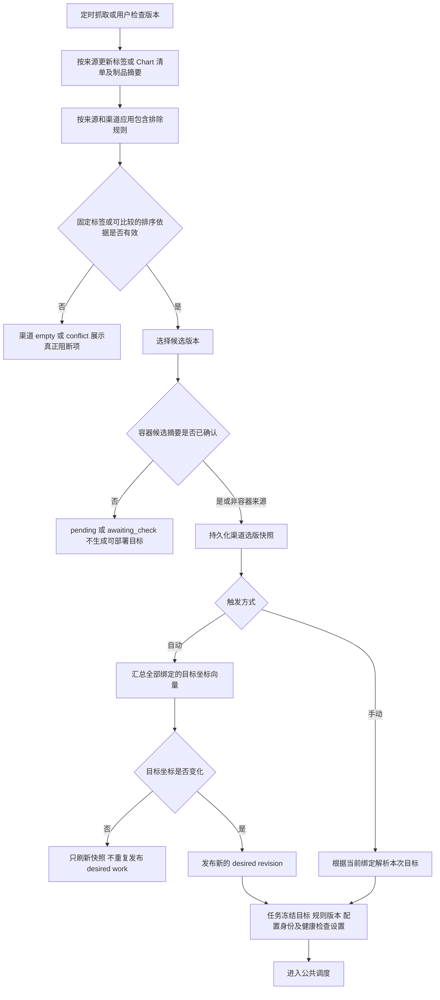
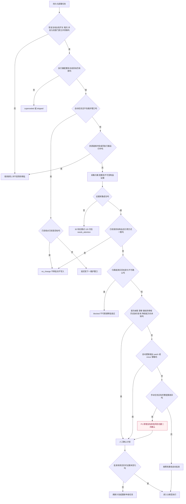
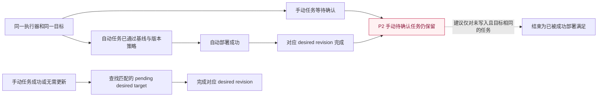
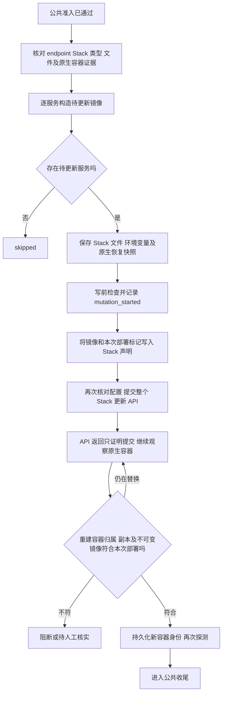
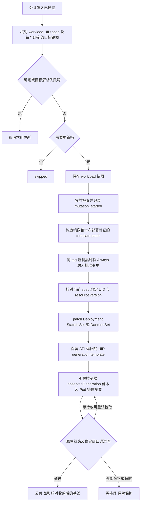
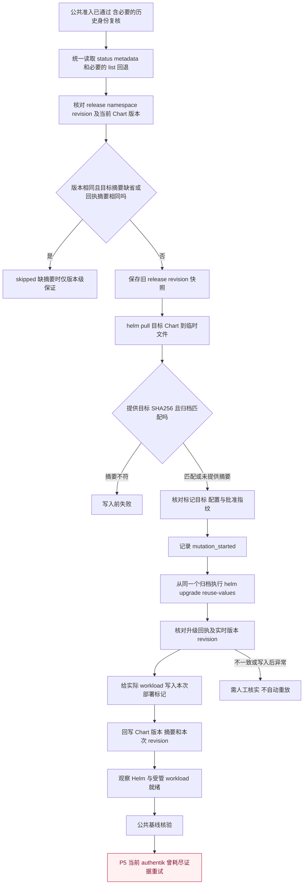
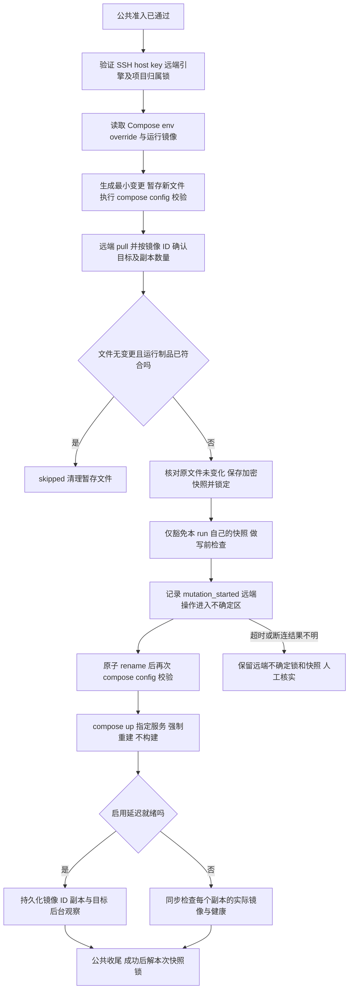
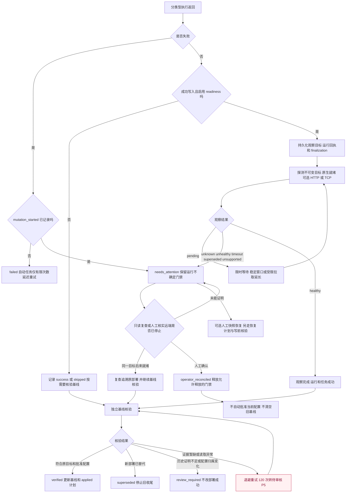

**执行器与版本更新流程审查 — 2026-10-26**

> 本文保留修改前的审查结果。后续实现及修改后的流程见[优化实施记录](executor-update-flow-implementation.md)。
代码基准：`4b3c6d76`。本轮前序只读核对显示，K3s 中三个核心源码文件与此提交一致；镜像标签仍为 `1.1.17`，不能只用镜像标签判断补丁是否部署。

本文描述当前代码实际行为。业务代码与线上数据均未修改。线上证据来自 2026-10-26 上海时间 14:08 左右的只读核对；其他分支以代码追踪为依据，未声称全部完成真实运行时验收。

**阅读约定**

- “成功”分成部署提交成功、就绪通过、基线核验通过，不能互相代替。
- 图中的“写前检查”包含租约、配置身份、资源范围、实时证据、批准指纹和维护窗口复核。部分适配器还在 stop、patch 或提交 API 前再核对配置。
- P1—P6 对应文末问题表；红色节点表示需要重点审查的位置，不表示已经发生未经授权的写入。
- 分类型图的入口都是公共准入通过之后。它们的出口都要进入公共就绪与基线收尾图。
- 手动执行仍使用已冻结的目标，不允许在等待期间静默改成新版本；自动执行跟随 desired revision，过期目标应退出。

**0. 支持的实际分支**

| 图号 | 连接类型 | 目标模式 | 实际写入方式 |
|---|---|---|---|
| 4 | Docker | container | Docker SDK 重建单容器 |
| 5 | Podman | container | Podman SDK 重建单容器，拒绝独立更新 Pod 成员 |
| 6 | Docker | docker_compose | 从运行容器配置重建选中服务，不执行 compose CLI |
| 7 | Podman | docker_compose | SDK 按单 Pod 范围重建服务和必要的 Pod 关系 |
| 8 | Portainer | portainer_stack | 更新 standalone Stack 声明并提交 Portainer API |
| 9 | Kubernetes | kubernetes_workload | patch Deployment / StatefulSet / DaemonSet |
| 10 | Kubernetes | helm_release | 拉取 Chart、核验摘要、从同一归档执行 Helm upgrade |
| 11 | SSH | ssh_compose | 远端 Compose 文件或 override，再执行 compose up |

Portainer 没有独立单容器更新分支；目前支持的是 standalone Stack，Swarm / Kubernetes Stack 不在这条支持路径。SSH 没有任意脚本执行器分支。Docker 连接如果指向 Podman 的 Docker 兼容 API，仍走 Docker 适配器，不能当成原生 Podman API。

**1. 版本发现、渠道选版与目标冻结**



容器标签使用真实 tag 参与排序，短哈希不能借 PEP 440 默认解析变成大版本。自定义 version / revision 提取和固定标签仍保留。版本时间元数据不用于排名。执行器仅绑定 container / helm 来源；GitHub 等发布信息可以用于展示或关联，但不能直接当成一个已存在的镜像。

主要代码：[选版快照](../backend/src/releasetracker/storage/sqlite_selection.py#L349)、[desired target 向量](../backend/src/releasetracker/executor_trigger.py#L25)、[目标解析](../backend/src/releasetracker/executor_scheduler_target_resolution.py)、[部署入队](../backend/src/releasetracker/services/deploy_tasks.py#L354)。

**2. 公共调度、无需更新与审批**



判断存在优先级，界面主原因不是所有检查结果的集合：归属或身份问题优先；版本降级 / 未知方向可覆盖 unmanaged / drift 的主原因；配置差异截断不可批准；`manual_update_review` 仅在前面无其他原因时添加。图把这些条件按用户可理解的层级展开，不表示代码同时返回全部原因。

手动任务绕过的是自动模式和维护窗口、patch / minor 范围限制；不会绕过配置归属、降级和未知方向、资源门禁、批准指纹。若本来已是目标，公共 prepare 会先返回 no_change，不会为了基线待审核而凭空重建。

真实目标变化与可复核的 Helm 历史身份变化不同：后者要证明原批准链、runtime、release 坐标、部署标记及旧基线一致，批准才转换身份；刷新计划不修改基线。

主要代码：[任务领取](../backend/src/releasetracker/storage/sqlite_tasks.py#L414)、[prepare](../backend/src/releasetracker/services/deploy_tasks.py#L488)、[准入原因](../backend/src/releasetracker/storage/sqlite_deployment_admission.py#L285)、[手动额外确认](../backend/src/releasetracker/storage/sqlite_deployment_admission.py#L333)、[版本方向与范围](../backend/src/releasetracker/services/version_policy.py#L73)。

**3. 手动与自动任务的完成关系：当前不对称**



线上实例：outline `2313` 手动任务等待 `manual_update_review`，而自动任务 `2314` 已在 14:08 更新到同一 `1.12.0` 并核验基线。此时继续呈现“需要部署”会误导。旧计划不会因此直接获得新授权，执行前仍需核对实时状态。

主要代码：[入队的触发模式与 supersede 选项](../backend/src/releasetracker/services/deploy_tasks.py#L354)、[完成处理](../backend/src/releasetracker/services/deploy_tasks.py#L713)、[同模式挂起任务替换](../backend/src/releasetracker/storage/sqlite_tasks.py#L59)。

**4. Docker 单容器**

```mermaid
flowchart TD
    A[公共准入已通过] --> B[核对容器 镜像与运行配置]
    B --> C{目标引用方式和制品已一致且不需要强制更新吗}
    C -->|是| D[skipped 进入公共收尾]
    C -->|否| E[持久化可恢复的更新前快照]
    E --> F[P3 调度器写前检查并记录 mutation_started]
    F --> G[Docker SDK 构造配置并 pull 镜像]
    G --> H{pull 和配置体积网络校验通过吗}
    H -->|否| I[失败 因标记已写入可能进入 needs_attention]
    H -->|是| J[适配器再次核对批准的运行配置]
    J --> K[stop 删除旧容器]
    K --> L[按保存配置创建并连接网络 启动新容器]
    L --> M[核对新容器实际配置和部署标记]
    M --> N[进入公共就绪与基线收尾]
    K -->|异常| O[不自动重放 写入状态待核实]
    L -->|异常| O
    classDef issue fill:#fff1f2,stroke:#be123c,color:#881337;
    class F I issue;
```

这里的主要路径是 SDK 重建，不是简单修改 image 字段。网络、挂载、命令、环境变量和镜像默认配置都属于重建核对范围。代码还保留兼容客户端的直接 update API 分支，实际客户端支持时在写前校验后调用。

主要代码：[单目标调度与快照](../backend/src/releasetracker/executor_scheduler.py#L442)、[Docker 重建](../backend/src/releasetracker/executors/docker.py#L172)。

**5. Podman 单容器**

```mermaid
flowchart TD
    A[公共准入已通过] --> B[校验原生 Podman 运行时与目标 lineage]
    B --> C{容器属于 Pod 吗}
    C -->|是| D[拒绝独立重建 不继续写入]
    C -->|否| E{无需更新吗}
    E -->|是| F[skipped]
    E -->|否| G[持久化快照]
    G --> H[P3 写前检查并记录 mutation_started]
    H --> I[构造 libpod 创建参数 核对卷 pull 镜像]
    I --> J[核对镜像默认配置及批准状态]
    J --> K[stop 删除旧容器]
    K --> L[创建新容器 恢复网络 启动 核对配置]
    L --> M[推进 lineage 进入公共收尾]
    I -->|失败且未重建| N[已写标记导致保守 needs_attention 风险]
    K -->|失败| O[人工核实或用快照恢复]
    classDef issue fill:#fff1f2,stroke:#be123c,color:#881337;
    class H N issue;
```

lineage 用来证明目前容器确实沿着此前批准的替换关系产生，不能用连接名称或随机变化的兼容 daemon ID 代替。经过 Docker API 代理的连接应使用 Docker 模式；不能绕过 Portainer 对 libpod 的访问限制。

主要代码：[Podman 单容器更新](../backend/src/releasetracker/executors/podman.py#L131)、[lineage 校验](../backend/src/releasetracker/executors/podman.py#L294)。

**6. Docker Compose，Docker SDK 路径**

```mermaid
flowchart TD
    A[公共准入已通过] --> B[逐服务解析被冻结目标和当前镜像]
    B --> C{某个绑定失败吗}
    C -->|是| D[取消本组待更新 不先更新一部分]
    C -->|否| E{存在待更新服务或同标签新制品吗}
    E -->|否| F[skipped]
    E -->|是| G[按运行配置保存整组快照]
    G --> H[P3 写前检查并记录 mutation_started]
    H --> I[根据实际容器构造重建计划及依赖顺序]
    I --> J[校验全部创建参数和卷 pull 全部目标镜像]
    J --> K[再次核对批准状态及镜像默认配置]
    K --> L[按逆序停止和移除旧容器]
    L --> M[按依赖顺序创建 恢复网络并启动]
    M --> N[逐容器核对配置 进入公共收尾]
    J -->|失败| O[P3 标记已写入 可能误升级为需处理]
    L -->|失败| P[可能部分完成 从整组快照人工恢复]
    classDef issue fill:#fff1f2,stroke:#be123c,color:#881337;
    class H O issue;
```

重要差异：此路径基于运行中容器配置，用 SDK 重建；它不会像 SSH Compose 那样修改磁盘上的 compose.yaml。外部继续用原 Compose 文件部署时，声明与运行配置是否一致需要单独核对。

主要代码：[Compose 分组调度](../backend/src/releasetracker/executor_scheduler_grouped_runtime_compose.py#L220)、[Docker 分组 SDK 更新](../backend/src/releasetracker/executors/docker.py#L48)。

**7. Podman Compose，原生 Pod 路径**

```mermaid
flowchart TD
    A[公共准入已通过] --> B[逐服务解析目标 核对副本镜像]
    B --> C{选中服务全在同一个 Pod 中吗}
    C -->|否| D[拒绝 不支持跨 Pod 或非 Pod 服务混组]
    C -->|是| E[校验 lineage 保存组快照及 Pod 关系]
    E --> F[P3 写前检查并记录 mutation_started]
    F --> G[检查全部创建参数和卷 pull 目标镜像]
    G --> H[再次核对批准状态及镜像默认配置]
    H --> I[逆序停止旧容器 改名并移除]
    I --> J[按必要范围恢复或重建 Pod 关系]
    J --> K[创建替换容器 恢复网络 启动 核对配置]
    K --> L[清理备份名称 推进 lineage]
    L --> M[进入公共收尾]
    G -->|失败| N[P3 未进入重建也可能 needs_attention]
    I -->|失败| O[保留不确定状态 人工按组恢复]
    classDef issue fill:#fff1f2,stroke:#be123c,color:#881337;
    class F N issue;
```

它与 Docker Compose 的支持范围不同，不能把两者描述为完全相同的服务重建。Pod 关系、成员、副本及网络都必须纳入快照和恢复核验。

主要代码：[Podman 分组计划与写入](../backend/src/releasetracker/executors/podman_compose.py#L23)、[共用调度](../backend/src/releasetracker/executor_scheduler_grouped_runtime_compose.py#L250)。

**8. Portainer standalone Stack**



Stack API 可能重建未升级服务，所以 skipped 服务也要核对归属及原镜像 ID；升级服务验证目标镜像。登记后再次被替换仍会阻断，不是每次看到新 ID 都接受。OpenBao 旧故障发生在这一衔接点和后续基线收尾。

额外待验：此调度分支未像 Docker / Podman Compose 那样显式在“任何绑定失败”时清空整个 pending_updates。公共准入能否覆盖所有服务失败路径，需要用多服务隔离场景确认，不能仅凭 API 成功判断整组成功。

主要代码：[Stack 调度](../backend/src/releasetracker/executor_scheduler_grouped_runtime_portainer.py#L239)、[Stack API 更新](../backend/src/releasetracker/executors/portainer.py#L277)、[替换容器归属与登记](../backend/src/releasetracker/services/deployment_readiness_probes.py#L530)。

**9. Kubernetes workload**



镜像已改写不等于更新成功。OnDelete、分区更新等不能假装已全部滚动完成。对明确可重试的镜像拉取问题存在有限延长期，但每次要重读证据，不沿用旧 Pod 状态。Pod 的暂时摘要缺失可进入证据重试，不能静默清除真实漂移。

主要代码：[workload 调度](../backend/src/releasetracker/executor_scheduler_grouped_runtime_kubernetes.py#L218)、[带并发条件的 patch](../backend/src/releasetracker/executors/kubernetes.py#L296)、[原生 rollout 与镜像核验](../backend/src/releasetracker/services/deployment_readiness_probes.py#L275)。

**10. Helm Release**



Chart 版本、摘要、revision、app_version 是运行回执，不参与固定目标身份；namespace、release 名等仍参与。摘要只在版本及 revision 与本次回执一致时有效；没有回执不能声称知道安装包摘要。OCI manifest digest 不能冒充 Chart 归档 SHA256。

P6：当前 Helm 审批 / 基线的配置投影只覆盖 chart_name、chart_version、revision，加上摘要证据；它没有完整保存和比较 values、manifest 或每个 workload 的有效配置。因此不能将这条路径称为与原生容器 / workload 相同的“完整配置审核”。revision 变化能提供部分变化信号，但不能替代完整配置内容验证。本文没有证明某次线上外部配置已被错误接纳。

线上实证：authentik `2241` 的部署结果 succeeded、观察 healthy / completed，执行器已保存 revision 34；基线却在 120 次后 review_required / evidence_exhausted，managed_targets.last_task_id 仍为 1501。具体是哪份制品证据或读取失败尚未复现，不能写成已修复。

主要代码：[Helm 调度与回执回写](../backend/src/releasetracker/executor_scheduler_grouped_runtime_helm.py#L155)、[单一事实入口](../backend/src/releasetracker/executors/kubernetes.py#L414)、[归档验证与升级](../backend/src/releasetracker/executors/kubernetes.py#L645)、[Helm 基线投影范围](../backend/src/releasetracker/services/recovery_diff.py#L87)。

**11. SSH Compose**



只允许本次 run 的快照豁免，不接受其他锁定快照。远端命令返回说明命令停止，不代表服务就绪。运行回执不明确时不能自动重放 up。与 SDK Compose 的关键差别是：这里确实会修改受管声明文件或 override。

主要代码：[SSH 调度](../backend/src/releasetracker/executor_scheduler_ssh.py#L69)、[远端暂存与写入](../backend/src/releasetracker/services/ssh_compose_deploy.py#L340)。

**12. 公共就绪、基线与失败恢复**



补充边界：

- 写入失败不自动回滚；需要快照恢复时走独立 recover 任务、恢复差异与批准流程。
- readiness 关闭不等于确认健康，只表示不等待就绪；基线仍要检查批准范围和目标制品。
- mark_degraded 是另一种健康检查结果呈现，不能把不健康任务说成健康，当前保留相应诊断。
- 重新核验基线只读，不重新部署，也不能补造旧审批证据。
- P3 的关键问题是“写入许可已记录”和“破坏性操作真正开始”目前共用一个标记，因此上图的失败分流存在保守误判。

主要代码：[guard 与 handoff](../backend/src/releasetracker/services/deploy_tasks.py#L621)、[失败分流](../backend/src/releasetracker/services/deploy_tasks.py#L695)、[就绪收尾](../backend/src/releasetracker/services/deployment_readiness.py#L625)、[独立基线重试](../backend/src/releasetracker/services/deploy_tasks.py#L248)、[基线结果校验](../backend/src/releasetracker/storage/sqlite_deployment_admission.py#L655)。

**13. 门禁范围不是每种执行器都已隔离**

| 目标 | 当前能使用的范围 | 影响 |
|---|---|---|
| 单个 Kubernetes workload | 读到有效 UID 时按 UID 区分 | 身份不明则退回全局 |
| SSH Compose | 已持久化并验证引擎归属时按 engine 区分 | 尚无归属时退回全局 |
| Docker / Podman / SDK Compose | 当前解析仍保守回退 `*` | 运行结果不明可能影响其他实例 |
| Portainer Stack | 当前保守回退 `*` | 必须证明跨连接指向同一 daemon 的关系才能安全缩小 |
| Helm | 当前保守回退 `*` | release 可能与 workload 执行器管理重叠资源 |

默认部署 / 恢复共享并发为 1，可配置到 3；提高并发不会消除 `*` 与资源重叠问题。仅基线待审核的成功任务不会像旧 OpenBao 故障那样重新制造有效全局观察门禁；真正 needs_attention 的不确定写入仍会阻挡。

主要代码：[范围解析](../backend/src/releasetracker/services/deployment_readiness.py#L61)、[UID 范围](../backend/src/releasetracker/services/deployment_readiness_probes.py#L866)、[队列锁和并发](../backend/src/releasetracker/storage/sqlite_tasks.py#L414)。

**14. 当前问题、证据等级与建议顺序**

| 编号 | 问题 | 证据等级 | 最小调整方向 |
|---|---|---|---|
| P1 | 无额外风险的手动更新仍统一二次确认，自动却可直接执行 | 代码及 outline 2313 / 2314 实证 | 明确产品策略：已纳管、无漂移且方向明确的预期更新是否允许直接执行；风险审批保留 |
| P2 | 自动成功不会对称清理同目标的手动待审批任务 | 代码及线上实证 | 仅结束未写入且执行器、目标制品与引用策略匹配的旧任务，保留审计，不改成伪成功 |
| P3 | mutation_started 早于 SDK pull / 创建参数预检，准备失败可能变成人工处理 | 代码顺序确认，未注入线上 pull 失败 | 写入授权与实际不可自动重放的步骤分开记录；未知写入仍保守阻断 |
| P4 | 非 UID / 已验证 SSH engine 目标仍使用全局资源范围 | 代码确认；历史 OpenBao 已出现跨实例影响 | 按验证后的 daemon / engine / 资源归属缩小范围，兼顾 Helm 与 workload 重叠 |
| P5 | 基线失败最终只见 evidence_exhausted，具体阻断证据不足 | authentik 2241 实证；具体核验失败根因未确认 | 持久化有限原因码、阶段和缺失证据摘要，区分读取异常与 artifact_unverified；先复现再修 |
| P6 | Helm 的“配置”投影没有 values / manifest / workload 有效配置 | 代码确认的保证边界，未证明线上误接纳 | 先确定审批与恢复应保证的范围，再决定补入哪些可稳定验证的声明；不要直接把动态 status 全量入 hash |

另有一项需隔离验证的风险：Portainer 与其他 grouped 执行器对绑定失败后的整组更新处理不一致，公共准入是否总能提前拦住尚需验证。

**建议先做 P1 / P2 / P3 / P5，再处理 P4 / P6。** P1 是产品策略，不能以“修 bug”为名默认去掉所有审批。P3 与 P4 会组合放大：准备阶段失败被误标为不确定写入，再占用全局范围，最终看起来整个队列卡住。P5 如果不保留真实原因，会让后续每次只能重新取线上证据猜测。

**15. 验收应按执行器和状态组合做，不能只看总测试数**

每个适配器应覆盖：无需更新、手动与自动同目标、正常升级、同 tag / 同 Chart 版本新制品、下载失败未写入、快照失败、批准后配置变化、写入后断连、就绪超时再复查、基线读取暂缺、被新部署替代、重启后继续收尾。

Helm 额外覆盖真实 status / metadata / list 输出、预发布版本、跨命令 revision 变化、外部升级、无回执摘要和 values 保证范围。Podman 覆盖 Pod 成员和同 Pod 分组；Portainer 覆盖未升级服务被 Stack 重建；SSH 覆盖原子 rename 回执丢失与本 run 快照锁豁免；Kubernetes 覆盖 API 并发条件、Pod 摘要和 OnDelete / partition。

本轮是流程审查与文档交付，未执行这些隔离写入测试，未触发线上部署、审批、取消或基线修复。前轮 2970 项后端测试通过不能作为以上全部产品链路已验收的证明。
